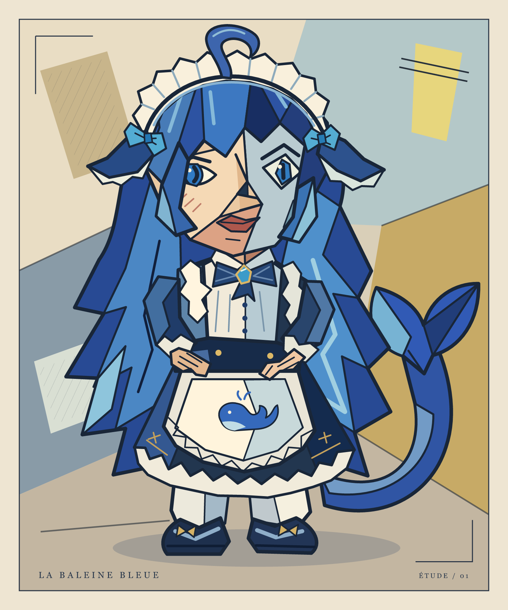
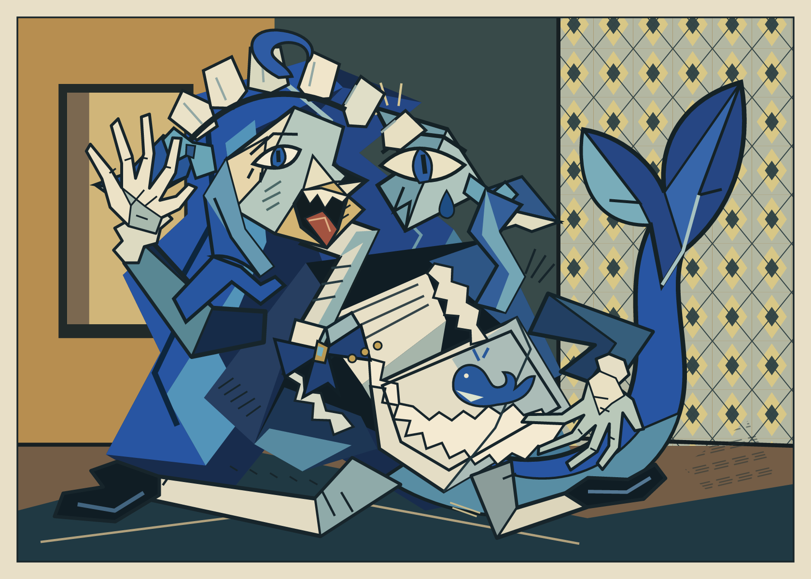
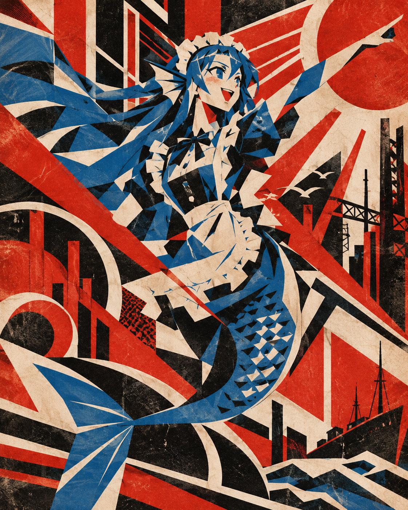
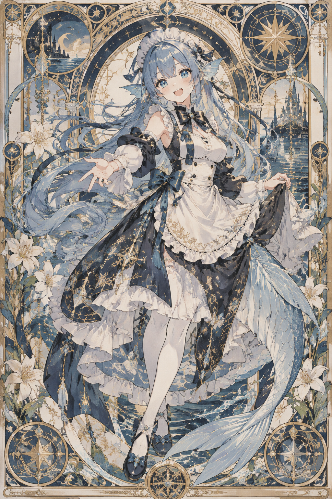
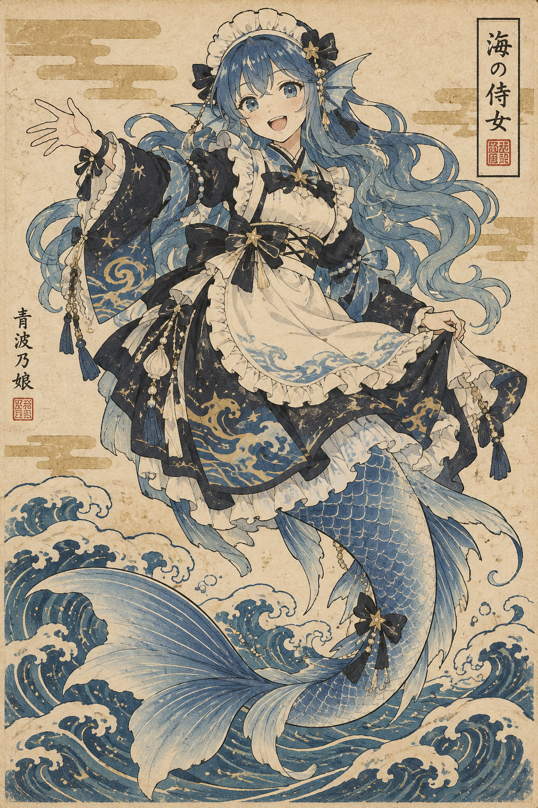
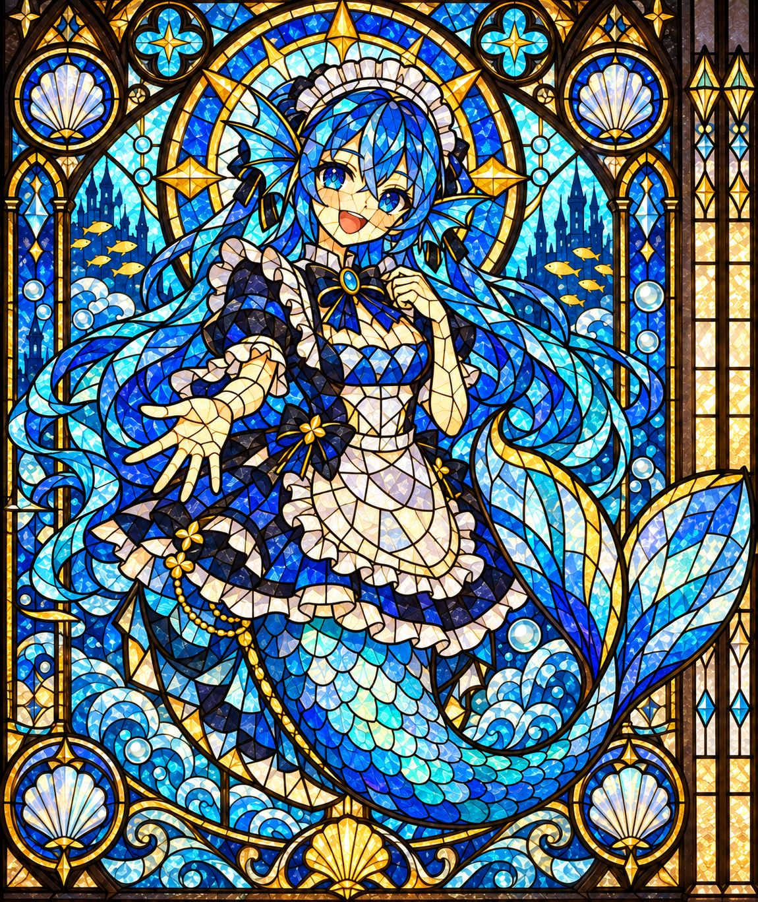
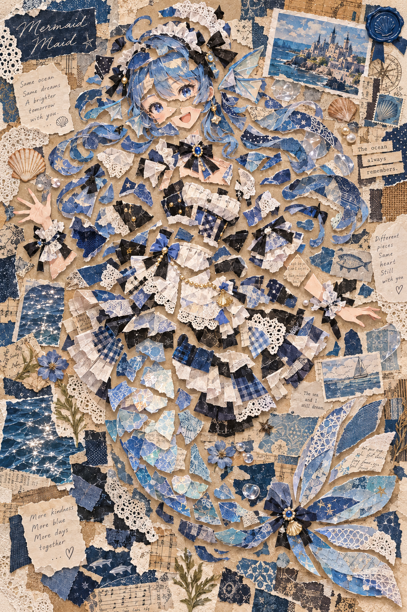

# 个人作品集

记录和分享不同风格的绘画、角色二创与视觉实验。这里会持续收录新的作品，探索色彩、形状、构图与情绪的不同表达。

## 作品画廊

按风格浏览作品，点击缩略图可查看原图。

[几何肖像](#几何肖像cubist) · [视觉实验](#视觉实验) · [构成主义](#构成主义) · [新艺术](#新艺术) · [浮世绘](#浮世绘) · [彩绘玻璃](#彩绘玻璃) · [异材质碎片拼贴](#异材质碎片拼贴)

目前收录 7 幅作品，其中 5 幅附有独立的提示词文件；其余作品的提示词状态在下方注明。

### 几何肖像（Cubist）

| 预览 | 作品 | 提示词 |
| --- | --- | --- |
|  | **蓝色的沉思**  蓝发鲸鱼娘的几何肖像，尝试以蓝色色面和不对称五官表现安静的神情。  [查看原图](whale-girl-cubist.png) | 仓库暂未提供对应提示词文件 |

### 视觉实验

| 预览 | 作品 | 提示词 |
| --- | --- | --- |
|  | **蓝鲸的失眠**  一场关于紧张与不安的视觉实验，让面孔、肢体与背景交错展开。  [查看原图](whale-girl-dislocated.png) | 仓库暂未提供对应提示词文件 |

### 构成主义

| 预览 | 作品 | 提示词 |
| --- | --- | --- |
|  | **鲸鱼娘 · 构成主义海报**  红、黑、米白与蓝色交织，以斜线、圆形和几何飘带构成充满动势的画面。  [查看原图](whale-girl-constructivist.png) | [查看完整提示词](whale-girl-constructivist.md) |

### 新艺术

| 预览 | 作品 | 提示词 |
| --- | --- | --- |
|  | **鲸鱼娘 · 新艺术风格**  流动的蓝发与鲸尾融入花卉、星象和海景装饰，以柔和蓝色与金色线条构成复古画框。  [查看原图](whale-girl-art-nouveau.png) | [查看完整提示词](whale-girl-art-nouveau.md) |

### 浮世绘

| 预览 | 作品 | 提示词 |
| --- | --- | --- |
|  | **鲸鱼娘 · 浮世绘风格**  以靛蓝、米白与赭色描绘鲸鱼娘，卷曲的海浪、装饰云纹与细线轮廓呈现复古木版画意趣。  [查看原图](whale-girl-ukiyo-e.png) | [查看完整提示词](whale-girl-ukiyo-e.md) |

### 彩绘玻璃

| 预览 | 作品 | 提示词 |
| --- | --- | --- |
|  | **鲸鱼娘 · 彩绘玻璃风格**  以黑色铅条分隔蓝、青、金色玻璃，将鲸鱼娘、海浪与贝壳纹样融入透光的装饰窗画。  [查看原图](whale-girl-stained-glass.png) | [查看完整提示词](whale-girl-stained-glass.md) |

### 异材质碎片拼贴

| 预览 | 作品 | 提示词 |
| --- | --- | --- |
|  | **鲸鱼娘 · 异材质碎片拼贴**  蓝发鲸鱼娘由纸张、织物与蕾丝等碎片拼合，错位的身体与鲸尾之间留出空隙，呈现蓝色与米白色交织的海洋主题拼贴。  [查看原图](whale-girl-mixed-media-collage.png) | [查看提供的提示词](whale-girl-mixed-media-collage.md) |

## 关于创作

本仓库收录个人构思、选择与迭代指导下完成的作品，部分创作使用 AI 辅助。随着作品积累，会逐步加入更多主题与表现手法。

鲸鱼娘系列的角色视觉参考：[TreapGoGo/deepseek-whale-girl](https://github.com/TreapGoGo/deepseek-whale-girl)。鲸鱼娘系列为个人二创，与 DeepSeek 官方无关联。
